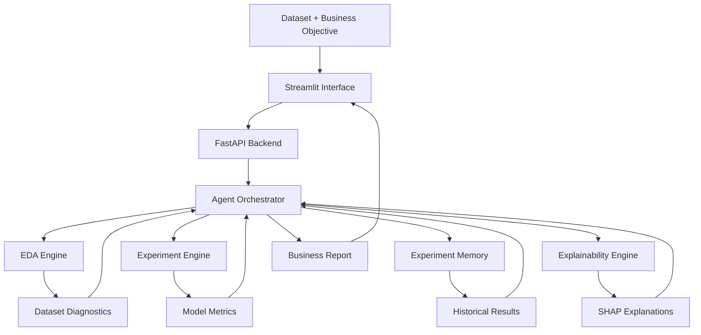
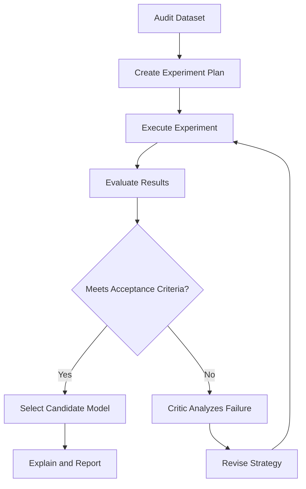

# Autonomous Data Scientist

### An AI-powered machine learning platform for automated data analysis, experimentation, model evaluation, and business intelligence.

**Autonomous Data Scientist** is an AI-driven machine learning platform designed to automate key stages of the data science workflow. Given a structured dataset and a business objective, the system analyzes data quality, identifies potential modeling issues, benchmarks machine learning algorithms, interprets model behavior, and generates actionable analytical reports.

The long-term goal is to move beyond static AutoML pipelines toward an **autonomous experimentation system** capable of proposing hypotheses, testing alternative modeling strategies, evaluating results, and refining its decisions based on empirical evidence.

The platform combines Python-based ML tooling, LLM-driven orchestration, model explainability, persistent experiment memory, and an interactive interface.

> **Project focus:** Autonomous ML engineering, intelligent experimentation, model reliability, and explainable AI.

---

## Table of Contents

- [Overview](#overview)
- [Key Features](#key-features)
- [Architecture](#architecture)
- [How It Works](#how-it-works)
- [Technology Stack](#technology-stack)
- [Project Structure](#project-structure)
- [Installation](#installation)
- [Configuration](#configuration)
- [Running the Application](#running-the-application)
- [API Reference](#api-reference)
- [Machine Learning Methodology](#machine-learning-methodology)
- [Experiment Tracking and Memory](#experiment-tracking-and-memory)
- [Explainability](#explainability)
- [Reliability and Security](#reliability-and-security)
- [Roadmap](#roadmap)
- [Limitations](#limitations)
- [Contributing](#contributing)
- [License](#license)

## Overview

Traditional data science workflows often require substantial manual effort across data inspection, feature preparation, model selection, evaluation, explainability, and reporting.

Autonomous Data Scientist aims to reduce this operational overhead through a modular system that combines deterministic Python tools with an LLM-based agent.

Instead of relying on an LLM to perform numerical analysis directly, the system delegates data processing, model training, and metric computation to executable tools. The agent orchestrates these capabilities and uses their results to determine subsequent actions.

### Design principles

- **Tool-driven intelligence:** Models and metrics are computed by Python libraries rather than generated by the LLM.
- **Evidence-based decisions:** Model selection relies on measurable performance and validation results.
- **Modular architecture:** Data auditing, experimentation, explainability, and orchestration remain separate concerns.
- **Explainability by design:** Predictions should be accompanied by interpretable evidence whenever supported.
- **Reproducibility:** Experiments should retain their configuration, metrics, and execution metadata.
- **Business orientation:** Analytical results should translate into understandable recommendations.

## Key Features

### 1. Automated Dataset Auditing

The EDA engine performs an initial analysis of structured datasets.

Capabilities include:

- CSV ingestion and structural inspection.
- Dataset dimensions and column-type detection.
- Missing-value analysis.
- Basic data-quality checks.
- Target and identifier-column handling.
- Class-distribution analysis.
- Initial leakage-risk heuristics.

The audit provides the information required to determine whether the dataset is suitable for supervised learning and which issues need attention before training.

### 2. Machine Learning Benchmarking

The experiment engine benchmarks tree-based algorithms for supervised learning.

Supported algorithms in the current implementation include:

- CatBoost
- LightGBM
- XGBoost

The evaluation layer can report classification metrics such as:

| Metric | Purpose |
|---|---|
| Accuracy | Overall proportion of correct predictions |
| Precision | Reliability of positive predictions |
| Recall | Proportion of actual positives detected |
| F1-score | Balance between precision and recall |
| ROC-AUC | Ranking performance across classification thresholds |

The appropriate selection criterion depends on the business objective, class distribution, and cost of prediction errors.

For example, customer churn detection may prioritize recall and F1-score over accuracy alone.

### 3. LLM-Based Agent Orchestration

The agent uses an LLM with tool-calling capabilities to coordinate the analytical workflow.

The current orchestration layer can:

- Request a dataset audit.
- Trigger model benchmarking.
- Invoke explainability tools.
- Consult experiment history.
- Generate a structured analytical report.

The LLM coordinates the process, while deterministic Python components remain responsible for numerical computation.

**Development direction:** extend the orchestration into an adaptive experiment loop in which evaluation results influence subsequent modeling decisions.

### 4. Persistent Experiment Memory

The experiment memory component stores historical experiment results in `experiment_memory.json`.

This enables the system to retain and compare previous results, identify promising configurations, and avoid treating each run as an entirely isolated operation.

The current JSON-based implementation provides a lightweight starting point. More advanced experiment tracking and model lifecycle management are planned.

### 5. Explainable AI with SHAP

The explainability module uses SHAP to investigate the contribution of input features to model predictions.

Current capabilities include:

- Tree-based SHAP explanations.
- Global feature-importance analysis.
- Summary visualization through a beeswarm plot.
- Export of the SHAP visualization to `charts/shap_summary.png`.

The objective is to make model behavior more transparent and help users identify influential variables.

Feature importance is not equivalent to causal influence: SHAP values explain model behavior, not necessarily the real-world causes of an outcome.

### 6. Automated Business Reporting

The agent produces a structured report covering:

- Dataset diagnostics.
- Model benchmark results.
- Model interpretation.
- Potential risks and limitations.
- Prioritized recommendations.

The goal is to bridge the gap between technical model evaluation and decisions that business stakeholders can understand.

### 7. Interactive Interface

The Streamlit interface provides a user-facing entry point for the analytical workflow.

The current application connects to the FastAPI backend and presents supported outputs, including model comparisons, analytical reports, and SHAP visualizations.

### 8. API-First Design

FastAPI separates analytical execution from the user interface.

This allows the same backend capabilities to support the Streamlit application, programmatic clients, and future integrations.

---

## Architecture



### Architectural responsibilities

| Component | Responsibility |
|---|---|
| Streamlit | User interaction and result presentation |
| FastAPI | HTTP API and request handling |
| Agent orchestrator | Tool selection and workflow coordination |
| EDA engine | Data profiling and initial diagnostics |
| Experiment engine | Model training and benchmark execution |
| Experiment memory | Persistence and comparison of historical results |
| Explainability engine | SHAP analysis and visualization |
| Reporting layer | Structured analytical findings and recommendations |

The architecture is designed to evolve toward a more autonomous, feedback-driven workflow without coupling the LLM to the underlying model implementations.

## How It Works

The intended end-to-end workflow consists of the following stages.

### Stage 1 — Data ingestion

A structured dataset is provided alongside a target column and a business objective.

### Stage 2 — Dataset audit

The system inspects data types, missing values, class balance, identifiers, and potential data-quality problems.

### Stage 3 — Experiment planning

The agent uses the audit findings and previous experiment results to identify candidate modeling strategies.

*Adaptive planning is an area of ongoing development.*

### Stage 4 — Model experimentation

Candidate algorithms are trained and evaluated using the experiment engine.

### Stage 5 — Evaluation and comparison

The system compares results using metrics appropriate to the task and business objective.

### Stage 6 — Model interpretation

SHAP is used to explain the selected model's behavior and identify influential features.

### Stage 7 — Reporting

The agent synthesizes the observed results into a structured report, including limitations and possible next steps.

### Target autonomous feedback loop

The planned advanced workflow introduces iterative experimentation:



The loop will use bounded execution, explicit acceptance criteria, and safeguards against invalid experiments. It is a target architecture, not a claim that every adaptive behavior is already implemented.

## Technology Stack

| Category | Technologies |
|---|---|
| Language | Python |
| Data processing | Pandas, NumPy |
| Machine learning | Scikit-learn, CatBoost, LightGBM, XGBoost |
| Explainable AI | SHAP |
| LLM orchestration | Groq API, tool/function calling |
| API | FastAPI |
| Interactive UI | Streamlit |
| HTTP client | Requests |
| Visualization | Matplotlib, SHAP plotting |
| Persistence | JSON-based experiment memory |
| API documentation | FastAPI / Swagger UI |

Exact package versions should be recorded in the project's dependency file to support reproducible installation.

## Project Structure

```text
autonomous-data-scientist/
│
├── agent.py
├── main.py
├── app.py
│
├── tools/
│   ├── eda_engine.py
│   ├── experiment_engine.py
│   ├── agent_memory.py
│   └── explainability.py
│
├── charts/
│   └── shap_summary.png
│
├── experiment_memory.json
├── requirements.txt
├── .env.example
├── .gitignore
└── README.md
```

The structure above reflects the core implementation described in the project documentation. Additional modules should be added as the experimentation, feature-engineering, and reliability layers are implemented.

## Installation

### Prerequisites

- Python 3.10 or a compatible supported version.
- pip.
- A Groq API key for LLM-based orchestration.
- Git.

### 1. Clone the repository

```bash
git clone https://github.com/bkrfethi/autonomous-data-scientist.git
cd autonomous-data-scientist
```

Replace the repository URL if the project is published under a different name.

### 2. Create a virtual environment

**Windows**

```powershell
python -m venv .venv
.venv\Scripts\Activate.ps1
```

**Linux / macOS**

```bash
python3 -m venv .venv
source .venv/bin/activate
```

### 3. Install dependencies

```bash
python -m pip install --upgrade pip
pip install -r requirements.txt
```

Ensure that `requirements.txt` includes the libraries used by the current implementation, including the API, UI, machine learning, explainability, and LLM clients.

## Configuration

Create a `.env` file in the project root.

```dotenv
GROQ_API_KEY=your_groq_api_key
```

Add other configuration variables only when required by the implementation.

Never commit `.env`, API keys, private datasets, or credentials to source control.

The exact model identifier and provider settings should be configured according to the implementation in `agent.py`.

## Running the Application

Run the commands from the project root.

### 1. Start the FastAPI backend

```bash
uvicorn main:app --reload
```

The backend will normally be available at:

```text
http://127.0.0.1:8000
```

Interactive API documentation:

```text
http://127.0.0.1:8000/docs
```

### 2. Start Streamlit

Open a second terminal, activate the same virtual environment, and run:

```bash
streamlit run app.py
```

Streamlit will print the local URL for the application.

### 3. Execute an analysis

1. Open the Streamlit interface.
2. Provide a supported dataset.
3. Specify the target column and business objective.
4. Launch the analysis.
5. Inspect dataset diagnostics and benchmark results.
6. Review the SHAP visualization and generated report.

The exact controls depend on the current interface implementation.

## API Reference

The backend exposes HTTP endpoints for the analytical workflow. The following are conceptual examples of the intended interface; verify the actual routes and request schemas in `main.py` and `/docs`.

| Endpoint | Intended responsibility |
|---|---|
| `GET /docs` | Interactive API documentation |
| `POST /upload` | Dataset ingestion |
| `POST /profile` | Dataset profiling |
| `POST /train` | Model training or benchmarking |

If additional endpoints are implemented, document their request fields, response schemas, error behavior, and examples here.

### Example response for a classification benchmark

```json
{
  "model": "XGBoost",
  "metrics": {
    "precision": 0.78,
    "recall": 0.81,
    "f1": 0.79,
    "roc_auc": 0.86
  }
}
```

This is an illustrative response format, not a measured result from the project.

## Machine Learning Methodology

### Evaluation strategy

A trustworthy machine learning system must separate model development from final evaluation.

The intended robust evaluation methodology includes:

1. Establish a simple baseline.
2. Split the dataset into training and validation data.
3. Apply preprocessing fitted exclusively on training data.
4. Compare candidate algorithms using consistent splits.
5. Use cross-validation where appropriate.
6. Evaluate the selected candidate on an untouched test set.
7. Record the final configuration and metrics.

The current implementation should be audited against these requirements before being described as leakage-safe or production-ready.

### Feature engineering

The planned Feature Engineering Engine will extend the pipeline beyond training on the original columns.

Potential transformations include:

- Date and time decomposition.
- Log transformations for skewed variables.
- Ratios and domain-informed derived features.
- Interaction features.
- Categorical transformations.
- Aggregations where the data structure supports them.

The agent should propose candidate transformations, but Python must validate their implementation. Candidate features must be evaluated without using information unavailable at prediction time.

Feature engineering must be performed within the training pipeline whenever data-dependent transformations are involved, to avoid leakage between training and validation data.

### Objective-aware model selection

The best model is not necessarily the one with the highest accuracy.

The selection strategy should account for the real objective:

- Churn prediction: recall, F1-score, and intervention capacity.
- Fraud detection: recall, precision-recall performance, and false-positive costs.
- Regression: MAE, RMSE, or other domain-appropriate losses.
- Imbalanced classification: class-specific metrics and suitable baselines.

Thresholds should be selected on validation data and evaluated against the operational costs of false positives and false negatives.

## Experiment Tracking and Memory

The existing JSON-based memory records experiment history.

The planned experiment-management layer will standardize each run with:

- Unique experiment identifier.
- Dataset fingerprint.
- Algorithm and model parameters.
- Preprocessing configuration.
- Evaluation protocol.
- Metrics and execution duration.
- Experiment status and rejection reason.
- Random seed and software versions.

MLflow is a planned addition for structured experiment tracking and model lifecycle management.

Persistent agent memory and experiment tracking serve different purposes: one preserves decision context, while the other records the technical details of model runs.

## Explainability

SHAP helps describe how input features contribute to model predictions.

The planned explainability improvements include:

- Global explanations.
- Individual prediction explanations.
- Comparison of explanations across candidate models.
- Analysis of explanation stability.
- Clear separation between correlation, model attribution, and causal claims.

Explanations should be generated for the selected model using the same preprocessing and feature representation used during training.

## Reliability and Security

A production-oriented autonomous ML platform must treat reliability as a first-class concern.

Planned safeguards include:

- Detection of suspicious identifiers and target leakage.
- Train/test separation and leakage-safe preprocessing.
- Cross-validation and overfitting diagnostics.
- Input validation and dataset-size limits.
- Bounded agent loops and experiment budgets.
- Parameter validation before model execution.
- Explicit error handling and structured logs.
- Secret management through environment variables.
- Safe file handling and controlled upload locations.
- Reproducible experiment configurations.

Automated leakage detection is heuristic rather than infallible. Suspicious columns should trigger investigation instead of being blindly removed.

**Security note:** the API should not expose arbitrary server-side file paths to untrusted clients. Uploaded files should be stored and referenced through controlled identifiers, with size and type restrictions.

## Roadmap

The project is being developed incrementally toward a more autonomous ML system.

### Phase 1 — Autonomous Feature Engineering

- [ ] Generate candidate features from dataset diagnostics.
- [ ] Validate proposed transformations.
- [ ] Detect invalid operations and suspicious leakage.
- [ ] Benchmark engineered features against a baseline.
- [ ] Retain features only when improvements are supported by validation results.

### Phase 2 — Autonomous Experimentation

- [ ] Introduce a standardized experiment manager.
- [ ] Build a data-driven experiment planner.
- [ ] Implement a bounded retry loop.
- [ ] Compare experiments using explicit acceptance criteria.
- [ ] Avoid redundant experiments.
- [ ] Record why each strategy was accepted or rejected.

### Phase 3 — ML Reliability Engine

- [ ] Implement cross-validation.
- [ ] Add untouched holdout evaluation.
- [ ] Detect overfitting and unstable performance.
- [ ] Strengthen leakage diagnostics.
- [ ] Support task-specific objective functions.
- [ ] Add Optuna-based hyperparameter optimization.
- [ ] Record dataset fingerprints and random seeds.

### Phase 4 — Critic Agent and Experiment Memory

- [ ] Introduce a critic responsible for reviewing experiment outcomes.
- [ ] Reject invalid or insufficiently supported conclusions.
- [ ] Feed evaluation findings back into experiment planning.
- [ ] Add structured experiment tracking with MLflow.
- [ ] Improve reproducibility and decision traceability.

### Phase 5 — Operational Decision Support

- [ ] Score individual records with the selected trained model.
- [ ] Export predictions and risk rankings to CSV.
- [ ] Add a what-if analysis interface.
- [ ] Extend local SHAP explanations.
- [ ] Provide downloadable analytical reports.

### Phase 6 — Production Engineering

- [ ] Add automated tests and continuous integration.
- [ ] Containerize the API and interface.
- [ ] Add structured logging and configuration management.
- [ ] Introduce controlled model persistence and loading.
- [ ] Add API authentication and request limits where required.
- [ ] Deploy the application and document its operational requirements.

## Limitations

The current system has several limitations that should be considered when interpreting its outputs:

- The initial benchmark focuses on a limited set of tree-based algorithms.
- Data-quality and leakage checks are not guaranteed to detect every issue.
- LLM-generated recommendations may be incomplete or incorrect.
- The JSON experiment memory is a lightweight persistence mechanism.
- SHAP explanations do not establish causality.
- Performance metrics depend on dataset quality, split strategy, and target definition.
- An autonomous workflow does not guarantee that the selected model is optimal.
- The platform requires further testing and hardening before use with sensitive or business-critical data.

The roadmap describes planned capabilities and should not be interpreted as proof that those capabilities are already implemented.

## Contributing

Contributions and technical feedback are welcome.

A useful contribution should:

1. Address a clearly defined problem.
2. Include tests where appropriate.
3. Preserve separation between orchestration and deterministic ML execution.
4. Document changes to model evaluation or data-processing behavior.
5. Avoid exposing credentials or private datasets.

## License

Choose and add a license before distributing the project publicly. Until a license is included, do not assume that the repository grants unrestricted permission to reuse or redistribute its code.

---

## Author

**Mohamed Fathi Boukourou**

AI / Machine Learning Engineering · Data Science · Software Engineering

- GitHub: [@bkrfethi](https://github.com/bkrfethi)
- Portfolio: [mohamed-fathi.vercel.app](https://mohamed-fathi.vercel.app)
- LinkedIn: [Mohamed Fathi Boukourou](https://www.linkedin.com/in/mohamed-fathi-boukourou-51753033a/)

*Building toward autonomous, reliable, and explainable machine learning systems.*
